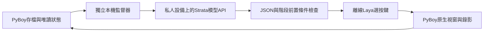

# Strata 地端決策橋接

更新：2026-10-23。目標是讓地端服務選擇已實作的遊戲階段，減少Codex逐輪續接與Computer Use畫面核對。Strata是推論服務，實際決策模型以該API目前載入、且通過目錄核對的模型ID為準。

**已完成私人Strata API與真實雙模型遊戲驗收。** Kevin確認私人設備後，核對模型總覽Hub、本機provider設定與認證，實際接到`qwen3.8-flash-next-iq3_s`；完成一輪測試及另外兩輪自動續接，共133次Laya按鍵決策。全程無Computer Use呼叫。見[實測收據](../results/strata-live-20261023.json)與[橋接就緒度](../results/strata-bridge-readiness-20261023.json)。

實際新增3級烈雀，妙蛙種子7級EXP254→288；最新存檔位於`outputs/strata-live-20261023-02/game-01/final.state`。三次正式Strata決策合計1810輸入／170輸出／1980總tokens；初始診斷另計545總tokens，不混入正式遊戲請求。59.33秒本機[實測影片收據](../results/strata-live-clip-20261023.json)記錄烈雀捕捉與後續對戰，MP4不上傳。



## 分工

- 監督器讀最新遊戲存檔複本、隊伍、劇情旗標與遊戲字碼文字；不讀私人筆記、其他應用程式或桌面截圖。
- Strata模型每輪選下一個高階階段，不是每一按鍵都呼叫大模型。候選僅包含當下前置條件成立且已實作的階段，以及review／stop。
- Python控制器提供導航、碰撞、選單與戰術子目標；Laya以CPU離線分類按鍵。遊戲子程序維持既有Python網路封鎖，沒有GPT備援。
- 獨立監督器才可呼叫明確設定的私人Strata API。金鑰只讀指定環境變數，不寫程式、策略、公開日誌或Git。
- 遊戲視窗與MP4由PyBoy直接產生，迴圈不呼叫Computer Use。已校準流程可以自動續接；未知畫面／學招／PC等仍需後續校準，不能宣稱全程自主破關。

## 已實作範圍

監督器會檢查開局、研究所對戰、包裹往返、圖鑑與首隻尼多朗♂等前置進度。已捕獲尼多朗家族後，team_training階段會在已知22號道路東側培養目前首位寶可夢，至13級停在里程碑。本次已實測此階段及跨輪續接，首位仍7級、未完成13級目標；不代表自動換人或平均培養所有隊員。訓練期間仍可按既有捕捉規則補入未持有的過渡成員，本輪烈雀即由此加入。

每個遊戲子程序仍上限60秒；監督器預設最多3輪、可指定1至20輪，達上限保存停止。只有正常時間／步數結束或里程碑才可考慮下一輪。使用者關窗、Ctrl+C、未知選單、模型錯誤、非法JSON、模型目錄不符及非正常遊戲退出，都不自動重啟或改接雲端。

模型回覆只能含stage／reason，禁止額外指令與工具呼叫；不接受重複JSON欄位、截斷回覆或候選外階段。模型不能提供shell、任意檔案路徑、任意座標或修改遊戲記憶體。

## 私人設定與啟動

確認設備確屬私人用途後，設定放在Git忽略的`.local/strata-planner.json`；不要將真實端點／金鑰寫進公開README或實驗日誌。下列是格式範例，模型ID必須換成API實際列出的ID；設備尚未確認時保留unconfirmed，程式會停止。

```json
{
  "device_lane": "unconfirmed",
  "base_url": "http://127.0.0.1:8080/v1",
  "model": "REPLACE_WITH_ACTUAL_LOADED_MODEL_ID",
  "api_key_env": "LAYA_STRATA_API_KEY",
  "timeout_seconds": 15
}
```

部署流程確認私人設備後才填入`private_personal_confirmed`，這個欄位不取代設備用途確認，也不能用來繞過私人／工作設備隔離。若伺服器不需要API key，api_key_env可留空；有認證時使用已存在的環境變數，不能把金鑰放在網址。程式不跟隨重新導向、不讀環境HTTP代理，並只接受本機、私人網路或Tailscale端點。

只核對模型目錄（不讀ROM／存檔或傳遊戲資料）：

```powershell
.\.venv\Scripts\python.exe -X utf8 scripts/strata_supervisor.py --config .local/strata-planner.json --probe-only --output outputs/strata-probe-01
```

完成連線與模型核對後，從已捕獲尼多朗的真實存檔啟動有限輪次：

```powershell
.\.venv\Scripts\python.exe -X utf8 scripts/strata_supervisor.py --config .local/strata-planner.json --state outputs/strata-live-20261023-02/game-01/final.state --output outputs/strata-session-next --episodes 3
```

輸出包含監督器summary.json、每次決策及API回報的token usage、逐輪策略、遊戲日誌、MP4與final.state。這些全部留本機；沒有回報usage時記為未知，不估算。Strata無法連線就保存錯誤停止，不借用GPT分類額度。

## 驗收與限制

合成測試涵蓋私人端點限制、環境變數認證、拒絕重新導向、JSON／階段限制、保留API實際usage，以及關窗後不重啟。這些測試不證明實際地端模型會選對策略。

已完成驗收：確認私人設備 → 核對模型與認證 → 階段JSON → 一輪Laya按鍵／錄影 → 另外兩輪自動續接，三輪存檔雜湊鏈均相符。初始地端理由曾誤提第二位隊員也會被培養，補上明確的stage_capabilities後，後續三次都正確描述首位訓練；仍由本機檢查候選、前置條件與輸出格式，不以模型自述作成果。

尚未驗證：13級訓練完成、全隊換人培養、四招忘招、PC管理、道館及全程通關。視覺能力也需另測，目前只送有限結構化遊戲狀態與字碼文字，未傳送影像或私人筆記。使用者提供的Hub根目錄不是推論API；連線應使用已核對的Strata項目，不能把404誤認成模型離線。

介面依據：[Strata官方API說明](https://github.com/Niko1221/Strata/blob/main/docs/DETAILS.md)。使用GET /v1/models與POST /v1/chat/completions、JSON schema回覆；客戶端仍自行驗證，不假設伺服器一定遵循schema。


## 第一道館連續任務（2026-10-23）

使用者明確要求持續至首館後，可加入`--until-first-gym --fast-forward`。此模式忽略有限輪數預算，仍每個遊戲子程序60秒並保存續接；關窗、未知選單與模型錯誤仍保存停止。完成條件是本機讀到小剛事件與灰色徽章，且完成對話後留下first-gym-milestone.json。現階段正實測，不能將新增路線寫成已通關。

`--fast-forward`解除模擬器幀率限制、增加戰鬥文字等待幀數，並啟用256筆程序內Laya分類快取。已解析的尋路／選單子目標只將objective與phase交Laya翻譯成按鍵；完整狀態與控制器貢獻留在steps。相同模型輸入、指令與候選才重用；prediction_cache_hit=true不算新增模型推論。沒有修改遊戲RAM、能力值或EXP，錄影時間仍是模擬時間，不能當牆鐘速度。

全圖尋路唯讀解析目前載入的地圖、與可見地圖逐格核對後才使用BFS；無法核對時回到既有可見碰撞格檢查。此功能是控制器工程輔助，並非Laya自己理解森林迷宮。訓練仍先培養首位至13級，再行道館路線；隊員不會自動分到EXP。


## 首館驗收結果（2026-10-23）

`first_gym`已實際完成：正常升到13級學藤鞭、森林訓練師、尼比市治療、館內訓練師與小剛、領獎後保存停止；最終妙蛙種子15級，灰色徽章與小剛事件均成立，存檔回讀一致。前文「尚未驗證」是先前時點，後續成果見[首館收據](../results/first-gym-campaign-20261023.json)與實驗日誌第22節。

本輪33個保存分段的狀態鏈相符，4,111次按鍵包含570次未快取分類與3,541次快取重用，也包含卡在門口／出口與Wait對話的重複動作，不能當作有效進展或成功率。Strata已知成功決策用量23,448 prompt／1,191 completion／24,639 total tokens；另一次失敗回覆697／70／767 tokens，首次失敗未保留usage，不能估計。遊戲未使用GPT fallback；Codex負責工程修復、研究與結果核對。

Laya曾把小剛台詞Wait!當成等待指令，導致領獎收尾停住；已將普通文字對話限制為A/B，確認為對話推進時只把objective與phase交分類，完整台詞保留稽核。這個案例也顯示分類器不應把遊戲台詞當作操作指令。
